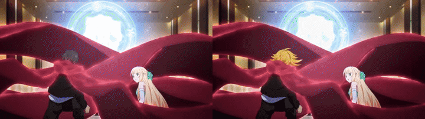
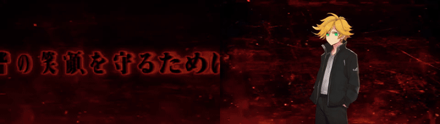
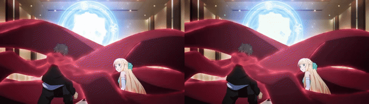
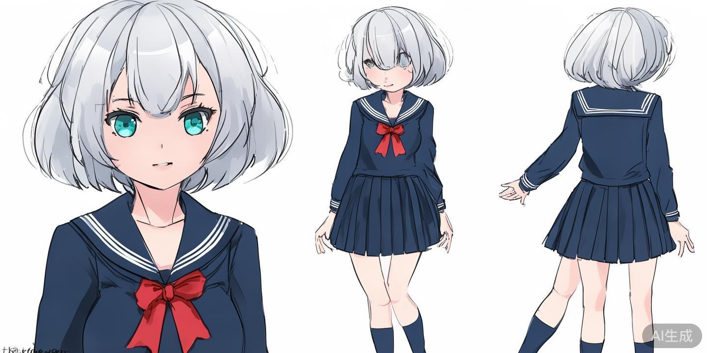
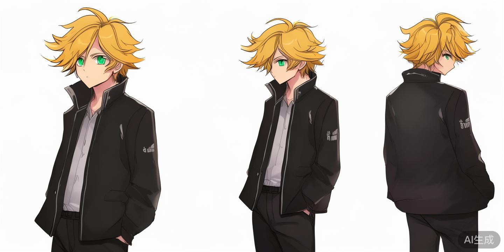

# Anime PV Character Replacement Pipeline

> 本仓库：**https://github.com/MrGendo/anime-pv-character-replacer**（public）

2026 年 10 月新番「マジカル★エクスプローラー」第1弾PV（Aniplex 官方频道）→ 截取两个代表性片段（A：双人魔法阵场景 5.3s / B：单人空中动作序列 9.4s）→ 用标准日式人设图替换视频中人物 → 三条替换路径 + 统一评估，全部真实运行、有据可查。

- PV 来源：<https://www.youtube.com/watch?v=bQuJywMCYWg>（官方） / 官网 <https://majieku.com>
- 素材来源与使用限制：[docs/MATERIALS.md](docs/MATERIALS.md)
- 评估方案设计：[docs/EVALUATION_DESIGN.md](docs/EVALUATION_DESIGN.md)
- 实验台账（全部 run + token 成本）：[docs/EXPERIMENT_LEDGER.md](docs/EXPERIMENT_LEDGER.md)
- 自动评估报告：[experiments/eval_20261012_w3eval.md](experiments/eval_20261012_w3eval.md)

## 结果速览（原片 vs 替换结果并排，左=原片 右=替换后）

### 片段 A × Seedance r2v（视频条件输入：动作保真路径，人物 → Jun）



A 段原片：[results/original_segments/A.mp4](results/original_segments/A.mp4) ｜ 成片：[results/final_videos/A_jun_r2v.mp4](results/final_videos/A_jun_r2v.mp4)
逐帧关键帧对比：[results/compare_grids/A_r2v_compare.jpg](results/compare_grids/A_r2v_compare.jpg)（6 时间点，左原右生成）

### 片段 B × Seedance（首帧锚定图生视频，人物 → Jun）



B 段原片：[results/original_segments/B.mp4](results/original_segments/B.mp4) ｜ 成片：[results/final_videos/B_seedance.mp4](results/final_videos/B_seedance.mp4)
关键帧对比：[results/compare_grids/B_seedance_compare.jpg](results/compare_grids/B_seedance_compare.jpg)

### 片段 A × sprite（本地零成本路径，人物 → Aoi，用户评审判定不合格的案例）



成片：[results/final_videos/A_sprite.mp4](results/final_videos/A_sprite.mp4) ｜ 四组合总览图：[results/compare_grids/overview_4combo.jpg](results/compare_grids/overview_4combo.jpg)

### 人设图（AI 生成原创角色，无第三方版权）

| Aoi（銀髪 sailor 少女） | Jun（金髪学兰少年） |
|---|---|
|  |  |

全部 8 个成片与 52 张对比图：[results/](results/)。

## 实现方式以及时间规划

六波次开发（W1-W4 委派 Claude Code 实现、本人逐波验收；W5/W6 本人执行），任务书与验收记录见 [docs/plan/](docs/plan/) 与 [docs/logs/](docs/logs/)：

| 波次 | 内容 | 实际耗时 | 验收 |
|---|---|---|---|
| W1 | 骨架/配置/切片/镜头边界 | 10min + 40min 侦察 | 5 tests ✅ |
| W2 | yolon 检测 + IoU 跟踪 | 18min + 20min | 12 tests ✅ |
| W3 | VLM grounding + sprite/palette 替换 + 合成 | 17min + 25min | 18 tests ✅ |
| W4 | 自动评估（5 指标加权） | 21min + 10min | 25 tests ✅ |
| W5 | 结果整理/发布 | 40min | 匿名 raw 验证 |
| W6 | Seedance 两条路径（首帧锚定 → r2v） | 90min | CV 确定性核验 |

预算 8-10h，实际 ~5.5h。每阶段验收 = pytest 全绿 + 真实命令出产物 + 本人抽查后才 commit（6 commits，逐波对应）。

## Pipeline 设计考量和侧重点

```
PV(1080p) → 镜头边界(HSV 差分, 53 镜头) → 片段 A/B 对齐镜头边界
  → 人物定位: VLM grounding(Qwen3-VL, keyframe@5+插值)   [yolon 检出率 11% 被淘汰]
  → IoU 跟踪 + bbox 平滑
  → 替换三路径:
      sprite   本地立绘贴入(零成本, 背景零污染, 无动作)
      palette  LAB 色板迁移(零成本, 跨片段最稳, 身份弱)
      seedance doubao-seedance-2-5: 首帧锚定图生视频 / r2v 视频条件输入(动作 0.97×)
  → ffmpeg 合成 → 自动评估(6 维 100 分制) + VLM 属性核验 + CV 确定性核验
```

侧重点：①跨片段复用——同一 config 同一命令跑 A/B，无按片段分支；②降级完备——无 key/无权重/无付费均有明确退路与人话提示；③证据链——每个 run 有 run_id + JSONL 日志，token/耗时全部落盘；④诚实标注——未运行的部分（如 anime-finetune YOLO）明确写「未做」。

## 结果评估方案的设计和考量

六维加权 100 分制（权重按替换任务成败分配：身份/动作/时序占 65%），两片段同一指标同一规则；自动指标纯 numpy/opencv 实现（CLIP 不可用，身份维度用 LAB 直方图相关+色板余弦的降级近似并注明）；盲评单独列示不混入自动分。完整定义：[docs/EVALUATION_DESIGN.md](docs/EVALUATION_DESIGN.md)。

### 片段 A、B 评分表（sprite/palette 路径，自动评估）

| 维度 | 权重 | A_sprite | A_palette | B_sprite | B_palette |
|---|---|---|---|---|---|
| 人物身份一致性 | 25% | 76.4 | 74.6 | 89.8 | 67.5 |
| 画面质量 | 15% | 93.9 | 70.9 | 84.4 | 56.0 |
| 动作一致性 | 20% | 98.3 | 97.0 | **18.9** | 86.8 |
| 时序稳定性 | 20% | 74.1 | 79.5 | **39.0** | 95.9 |
| 背景保真度 | 10% | 99.1 | 88.5 | 98.6 | 89.5 |
| 跨片段泛化 | 10% | 66.4 | **95.7** | 66.4 | **95.7** |
| **总分** | 100% | **84.2** | **83.0** | **63.2** | **80.3** |

Seedance 路径未入自动评分表（评估器针对局部替换设计，r2v 是整段重生成、背景维度不适用）；其质量以 CV 确定性核验呈现：**A_jun_r2v 动作幅度比 0.97（逐帧光流贴合原片）、镜头1 帧相关 0.95-0.99、镜头2 特写构图漂移（corr~0.4）**；B_seedance 身份 VLM 核验 4/4 符合人设。

### 稳定性与泛化

- 完成率：sprite/palette 四组合失败帧 0；Seedance 5 次任务全部 succeeded（含 2 次参数探针被 400 拒绝——探针本身零费用）
- 跨片段泛化：palette 小计差 2.7 分（最稳）；sprite 21.0 分（动作段崩，方法性上限）
- 实际耗时：本地替换 sprite 8.2/5.6 ms/帧、palette 81/38 ms/帧（A/B）；Seedance 单次 167-447s 墙钟
- 人工干预：本地路径 0；Seedance 路径 2 次（首帧版动作不足后改 r2v——即下述失败案例）

## AI coding 工具、Token 用量及主要消耗环节

Claude Code CLI（claude -p，GLM-5.3 后端）四波次委派；用量取自 `--output-format json` 的 usage 字段，原始记录 [docs/logs/taskW*_claude.json](docs/logs/)：

| 波次 | turns | 时长 | input | output | cache_read |
|---|---|---|---|---|---|
| W1 | 50 | 600s | 94,988 | 22,687 | 1,915,392 |
| W2 | 74 | 1055s | 75,745 | 50,222 | 3,175,424 |
| W3 | 76 | 1031s | **147,355** | **62,017** | 4,369,728 |
| W4 | 45 | 1231s | 107,111 | 65,778 | 3,828,544 |
| 合计 | 245 | 3917s | 425,199 | 200,704 | 13,289,088 |

最耗环节：**W3**（单波 input/output 双最高——VLM grounding+双替换路径+合成 CLI 三模块同波）；W4 时长最长但 turns 最少（评估映射调试往返多）。另有本人直接消耗：SiliconFlow Qwen3-VL ~200 次调用（帧扫描/grounding/核验，订阅内）；Seedance 5 次生成共 1,824,600 completion tokens（详见台账）。

## 个人投入时间最多的部分（不含 LLM 直接完成的工作）

1. **素材侦察与选段（~1.5h）**：yt-dlp 检索 3 部候选 PV → VLM 逐帧扫描（58 帧）→ 与镜头边界交叉裁定 A/B；识别 VLM 幻觉框（魔法阵特效被报「人物」）靠裁剪回验法逐框排除
2. **Seedance 能力逆向（~1h，W6）**：官方文档站反爬全拦截，改用 API 报错探针逐条逆向出 r2v 规则（role=reference_video / 必须公网 URL / 像素数下限 407,696），再搭 GitHub raw 直链供视频输入
3. **检测域间隙决策（~40min）**：yolon(COCO) 对动画远景 11% 检出率的实测、归因与 VLM grounding 替换决策
4. **逐波验收与确定性核验（~1.5h）**：每波 pytest 亲自跑 + 真实命令跑 A/B；W6 的动作保真（光流比）、构图保真（帧相关）、身份（HSV 金发检测）全部用可复算的 CV 脚本而非 AI 评审

## 失败案例分析：问题、原因及改进方向

1. **sprite 贴图被用户判定不合格**（「框不是脸、贴全身照片」）：bbox 是身体框、立绘无动作，静态贴纸与动态场景根本错配。改进：视频生成模型重生成（W6 已落地）；sprite 保留为零成本基线
2. **Seedance 首帧锚定版「基本没有动作」**：单帧+文本条件下模型自由发挥动作。改进 A：首尾帧锚定（首帧 corr=1.000 但 2s 被钳到 5s 动作变慢 0.38×）；改进 B（终解）：**r2v 整段视频条件输入，动作 0.97×**
3. **yolon(COCO) 动画域失效**（A 段 11%）：照片域模型 vs 赛璐璐远景。已切 VLM grounding；根治方向 anime-finetune YOLO（未做）
4. **VLM grounding 幻觉框**：特效帧报「人物」。裁剪回验识别；keyframe 间隔+跟踪平滑缓解；特效过滤判定未实现
5. **sprite 在快切段崩坏**（B 动作 18.9/闪烁 1.51）：方法性上限。palette 在同段 95.9 佐证管线无恙
6. **r2v 特写镜头构图漂移**（corr~0.4）：模型对特写重构而非逐帧复刻。改进方向：分镜头 r2v + 拼接（未做）
7. **VLM 盲评无区分度**（16 样本 15 个全 5 分）：宽容偏差+未替换帧稀释。已改属性级核验+CV 确定性指标
8. **glm-4.5v 429 / SF 过载 / 官方文档反爬**：外部依赖三连坑，全部如实记录于台账并给出绕行（SiliconFlow 池 / API 探针逆向）

## 复现

```bash
make setup && make test          # uv venv + 25 tests
# 本地路径（零成本）
uv run python -m anime_pv_replacer.segment --config config/pipeline.yaml --stage cut
SILICONFLOW_API_KEY=sk-... uv run python -m anime_pv_replacer.vlm_grounding --config config/pipeline.yaml --segment A
uv run python -m anime_pv_replacer.track --config config/pipeline.yaml --segment A --stage track
uv run python -m anime_pv_replacer.compose --config config/pipeline.yaml --segment A --method sprite --chara-sheet assets/character_sheets/chara_aoi_sheet.png
uv run python -m anime_pv_replacer.evaluate --config config/pipeline.yaml --run-dir output/20261012_w3eval
# Seedance 路径（付费，需 ARK_API_KEY + 源视频公网 URL）
uv run python scripts/seedance_refvideo.py <video_web_url> assets/character_sheets/chara_jun_sheet.png out.mp4 5 720p
```

外部依赖：`SILICONFLOW_API_KEY`（VLM 检测/扫描）、`ARK_API_KEY`（Seedance 付费路径）、原始 PV 用 yt-dlp 下载（命令见 MATERIALS.md，原视频不入 git）。
